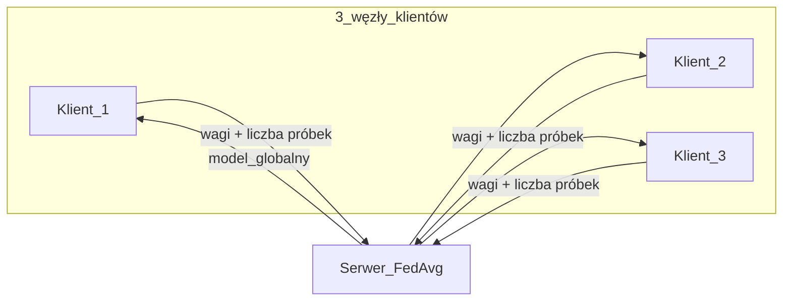
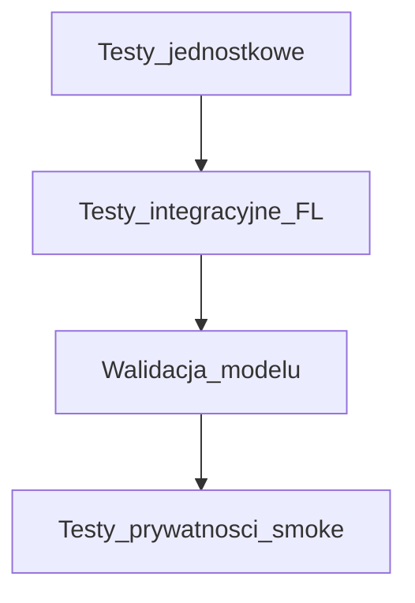

# Plan realizacji: Rozproszona detekcja anomalii (FedAvg)

Projekt jest zaliczany w ramach dwóch przedmiotów jednocześnie: **ZTKiK** (Zaawansowane Techniki Kryptografii i Kryptoanalizy) oraz **MSIwC**. Realizujemy **Scenariusz 2** (wymagania MSIwC w sekcji 4, wymagania ZTKiK w sekcji 5).

---

## 1. Wyjaśnienie projektu

### 1.1 Problem biznesowy i badawczy

Organizacje z sektora bankowego lub energetycznego widzą ten sam typ zagrożeń sieciowych (np. **DDoS**, **skanowanie portów**), ale nie mogą po prostu scalić swoich logów ruchu, bo dane są wrażliwe i objęte tajemnicą przedsiębiorstwa. Potrzebna jest **wspólna detekcja anomalii** bez centralizacji surowych rekordów.

**Uczenie federacyjne (Federated Learning, FL)** rozwiązuje to tak, że:

- każda instytucja trenuje model **lokalnie** na własnym ruchu;
- do serwera trafiają wyłącznie **aktualizacje modelu** (wagi sieci) i liczba próbek, a nie rekordy ruchu;
- serwer łączy aktualizacje algorytmem **FedAvg** i rozsyła model globalny z powrotem do węzłów.

Symulujemy **3 niezależne węzły** na zbiorze **NSL-KDD**. Zadanie ML: rozpoznać ruch **normalny vs atak**, z raportowaniem osobno dla kategorii **DoS** i **Probe**. Kategoria U2R nie jest uwzględniana w zadaniu.

### 1.2 Threat model

**Multi-tenant Privacy-Preserving Monitoring.** Zakładamy model **honest-but-curious server**:

- serwer koordynujący wykonuje protokół poprawnie, ale **nie powinien** otrzymywać danych treningowych klientów;
- celem jest ochrona **tajemnicy przedsiębiorstwa** przy wspólnej obronie przed zagrożeniami;
- szkic dokumentu `docs/threat_model.md` (aktywa, granice ochrony) powstaje w części 3.5, a w części 4.4 jest uzupełniany o analizę rozszerzonej prywatności (DP-SGD, Secure Aggregation lub Membership Inference wraz z kosztem w F1).

Protokół klient → serwer przenosi wyłącznie wagi i `num_examples`, co weryfikuje test „privacy smoke” (`docs/privacy_protocol.md`, `src/privacy.py`).

### 1.3 Kryterium sukcesu

- **F1 > 0,89** dla modelu **globalnego** po FedAvg, mierzone na `KDDTest+`. Jeśli kryterium nie zostanie spełnione, raportujemy wynik uczciwie wraz z analizą przesunięcia rozkładu (R2L: około 1% w train, około 13% w teście), bez zmiany zbioru ani progu po fakcie (`docs/evaluation_protocol.md`).
- Brak ujawniania **lokalnych rekordów treningowych** w kanale klient → serwer.

### 1.4 Słownik

| Skrót | Znaczenie |
|-------|-----------|
| FL | Federated Learning, uczenie bez centralizacji danych |
| FedAvg | Uśrednianie wag modeli z klientów (McMahan et al., 2017) |
| NSL-KDD | Ulepszona wersja KDD Cup 99, cechy połączeń TCP/UDP |
| Shard | Podzbiór danych przypisany jednemu klientowi FL |
| MLP / AE | Perceptron wielowarstwowy / autoencoder (dwie architektury projektu) |

### 1.5 Architektura (schemat)

---

## 2. Sposób wykonania

### 2.1 Decyzja techniczna (kickoff)

Wybrany stos: **PyTorch + Flower (`flwr`)**. Powód: projekt ma demonstrować rozproszony trening i agregację wag, a Flower + PyTorch najlepiej to odzwierciedla i pozwala dodawać rundy bez przepisywania orkiestracji. Algorytm agregacji `fed_avg` jest **autorski** (`src/fedavg.py`) i niezależny od architektury modelu; scikit-learn służy do preprocessingu i metryk.

### 2.2 Stos narzędzi

| Warstwa | Narzędzie |
|---------|-----------|
| Język | Python 3.10+ |
| Modele | PyTorch: MLP oraz autoencoder (część 2.3) |
| FL | Flower (`flwr`) oraz uruchomienie w jednym procesie (`src/run_federated.py`) |
| Dane | `pandas`, `numpy`, `scikit-learn`; mirror NSL-KDD z sumami SHA-256 w `docs/data_checksums.json` |
| Metryki | `src/evaluate.py` (F1, precision, recall, accuracy, ROC-AUC, macierz pomyłek, skuteczność per kategoria) |
| Wykresy | `matplotlib` |
| Testy | `pytest` (znacznik `integration` dla pełnej pętli FL) |
| CI | GitHub Actions z `pytest` (część 4.5) |
| Wersjonowanie | `git`, pull requesty z review co najmniej 1 osoby |

Dane: oryginalna strona UNB jest niedostępna, więc korzystamy z mirrora https://github.com/Jehuty4949/NSL_KDD (licencja NSL-KDD pozwala na mirrorowanie).

### 2.3 Przepływ end-to-end

1. Wczytanie `KDDTrain+` i `KDDTest+` z mirrora, weryfikacja sum SHA-256.
2. Preprocessing metodą nr 1 (pełne 122 cechy) i metodą nr 2 (ekstrakcja cech); dopasowanie wyłącznie na zbiorze treningowym.
3. Podział treningu na **3 shardy** w trzech wariantach: IID, Dirichlet, Category.
4. Na każdym shardzie podział 80/20 na trening i walidację lokalną; klient **nie ładuje** `KDDTest+`.
5. **Rundy FL:** klient trenuje lokalnie od wag globalnych, wysyła wagi i liczbę próbek, serwer wykonuje weighted FedAvg.
6. Po każdej rundzie ocena globalna na `KDDTest+` po stronie serwera, log rundy w JSON z sekcją `by_category`.
7. Raport końcowy: threat model, opis protokołu, wykresy F1 vs runda, tabele (średnia i odchylenie z ≥ 3 ziaren), analiza przesunięcia rozkładu.

Wzór agregacji (weighted FedAvg):

$$
w_{global} = \sum_{k=1}^{N} \frac{n_k}{n} w_k, \quad n = \sum_k n_k
$$

### 2.4 Metryki i sposób ich liczenia

Klasa dodatnia = **atak** (`is_attack = 1`). Model zwraca wynik ataku `s` (MLP: prawdopodobieństwo ataku, autoencoder: błąd rekonstrukcji). Rekord jest klasyfikowany jako atak, gdy `s ≥ τ`; dla MLP `τ = 0,5`, dla autoencodera `τ` jest dobierany na zbiorze walidacyjnym. Z porównania z etykietą powstają liczności: **TP** (atak wykryty), **FP** (fałszywy alarm), **FN** (atak przeoczony), **TN** (normal rozpoznany poprawnie). Wszystkie metryki liczy `src/evaluate.py` (scikit-learn) na tych samych tablicach `numpy` dla baseline'u, modeli lokalnych i modelu globalnego.

| Metryka | Wzór | Jak jest liczona w projekcie |
|---------|------|------------------------------|
| **F1** (główna) | $F1 = \frac{2PR}{P+R} = \frac{2\,TP}{2\,TP + FP + FN}$ | Średnia harmoniczna precision i recall dla klasy atak; kryterium sukcesu F1 > 0,89 na `KDDTest+`. Przy zerowym mianowniku wynik to 0. |
| **Precision** | $P = \frac{TP}{TP + FP}$ | Jaka część alarmów jest prawdziwym atakiem. Przy braku alarmów wynik to 0. |
| **Recall** (czułość, TPR) | $R = \frac{TP}{TP + FN}$ | Jaka część ataków została wykryta. |
| **Accuracy** | $\frac{TP + TN}{TP + TN + FP + FN}$ | Udział poprawnych decyzji. Pomocnicza, bo zależy od proporcji klas (atak: 47% w train, 57% w teście). |
| **ROC-AUC** | pole pod krzywą ROC: $TPR(\tau)$ względem $FPR(\tau)$ | Liczone z wyniku ciągłego `s`, bez progu: to prawdopodobieństwo, że losowy atak dostanie wyższy wynik niż losowy ruch normalny. 0,5 oznacza zgadywanie. Gdy w danych jest jedna klasa, wynik to `NaN`. |
| **Macierz pomyłek** | `[[TN, FP], [FN, TP]]` | Cztery liczności dla progu `τ`, zapisywane jako `tn, fp, fn, tp`. |
| **FPR / TNR** | $FPR = \frac{FP}{FP + TN}, \; TNR = 1 - FPR$ | Odsetek fałszywych alarmów na ruchu normalnym. |
| **Skuteczność per kategoria** | $\frac{\text{poprawnie sklasyfikowane w kategorii}}{\text{wszystkie w kategorii}}$ | Dla DoS, Probe i R2L to recall w danej kategorii (współczynnik wykrycia), dla `normal` to TNR. Kategoria jest tylko etykietą analizy, nie wejściem modelu. |
| **Błąd rekonstrukcji (MSE)** | $e(x) = \frac{1}{d} \sum_{j=1}^{d} (x_j - \hat{x}_j)^2$ | Wynik autoencodera: średni kwadrat różnicy między wejściem a rekonstrukcją (`d = input_dim`). Autoencoder uczy się wyłącznie na ruchu normalnym, więc atak ma zwykle większy błąd. |
| **Próg autoencodera** | $\tau^* = \arg\max_\tau F1_{val}(\tau)$ | Wybierany wyłącznie na walidacji (np. maksymalizacja F1 lub wysoki percentyl błędów ruchu normalnego); reguła jest zamrażana w części 4.2 i nie zmienia się po zobaczeniu `KDDTest+`. |
| **Walidacja globalna w FL** | $m = \sum_k \frac{n_k}{n}\, m_k$ | Walidacja globalna to suma walidacji lokalnych (20% każdego shardu). Gdy klienci raportują metryki osobno, są uśredniane z wagą liczby próbek `n_k`; dokładne wartości F1 dają zsumowane macierze pomyłek. |
| **Średnia i odchylenie** | $\bar{m} = \frac{1}{S}\sum_s m_s, \; \sigma = \sqrt{\frac{1}{S-1}\sum_s (m_s - \bar{m})^2}$ | Dla `S ≥ 3` ziaren losowości na każdą konfigurację; odchylenie z próby. |
| **Koszt prywatności** | $\Delta F1 = F1_{\text{bez ochrony}} - F1_{\text{z ochroną}}$ | Różnica F1 modelu globalnego bez i z DP-SGD lub Secure Aggregation, na tej samej konfiguracji i ziarnach (część 4.4). |
| **Skuteczność Membership Inference** | ROC-AUC klasyfikatora „rekord był w treningu” | Liczone jak ROC-AUC, na rekordach należących i nienależących do treningu; 0,5 oznacza brak wycieku (część 4.4). |

Strojenie (epoki, rundy, `lr`, próg) opiera się wyłącznie na metrykach walidacyjnych. `KDDTest+` służy do jednorazowego pomiaru końcowego (`docs/evaluation_protocol.md`).

---

## 3. Etapy i części

### Etap 1 (M1): Podział bazy NSL-KDD na 3 klientów (dane i obróbka)

| Część | Zakres |
|------|--------|
| 1.1 | Preprocessing: etykiety, `log(1+x)`, standaryzacja, one-hot, dopasowanie wyłącznie na zbiorze treningowym (metoda obróbki nr 1) |
| 1.2 | Sharding na 3 klientów: IID, Dirichlet, Category |
| 1.3 | Skrypt `evaluate.py`, protokół ewaluacji i podział walidacyjny |
| 1.4 | Analiza EDA, kontrola duplikatów, sumy kontrolne SHA-256 plików danych, `.gitattributes` (końce linii), wpisy w `requirements.txt` |
| 1.5 | Ekstrakcja cech (metoda obróbki nr 2): usunięcie cech stałych i skorelowanych, selekcja cech lub PCA, porównanie z pełnymi 122 cechami; `input_dim` pobierany dynamicznie z danych |

**Kamień milowy M1: Dane.** Jedno polecenie generuje dane po obu metodach obróbki oraz trzy shardy w trzech wariantach, a `input_dim` nie jest definiowany ręcznie. Zajęcia nr 2.

### Etap 2 (M2): Trening lokalnych modeli (dwie architektury)

| Część | Zakres |
|------|--------|
| 2.1 | Walidacja lokalna w podziale 80/20 i ocena przez `evaluate.py`; klient nie ładuje `KDDTest+` |
| 2.2 | Ziarno losowości zależne od rundy oraz decyzja dotycząca resetowania optymalizatora Adam |
| 2.3 | Autoencoder trenowany na ruchu normalnym: błąd rekonstrukcji jako wynik, próg dobrany na zbiorze walidacyjnym, ujednolicony interfejs wag zgodny z MLP |
| 2.4 | Baseline scentralizowany (MLP i autoencoder) oraz zapisane wyniki modeli lokalnych dla trzech klientów i partycji (`results/`) |

**Kamień milowy M2: Obie architektury lokalnie.** W `results/` są wyniki obu modeli (lokalnie i scentralizowanie): metryki walidacyjne oraz ocena końcowa na `KDDTest+`. Zajęcia nr 3.

### Etap 3 (M3): Agregacja wag FedAvg

| Część | Zakres |
|------|--------|
| 3.1 | Serwer: strategia wywołująca autorski `fed_avg` (ważony `n_k/n`), niezależna od architektury |
| 3.2 | Ocena globalna po każdej rundzie na `KDDTest+` po stronie serwera, agregacja walidacji klientów ważona liczbą próbek, logi rund w JSON z sekcją `by_category` (osobno DoS i Probe) |
| 3.3 | Runner: pętla rund w jednym procesie sterowana konfiguracją (partycja, liczba rund, epoki, `lr`, seed) oraz tryb demonstracyjny z serwerem i 3 klientami przez localhost |
| 3.4 | Testy: poprawność `fed_avg`, integracyjny test 3 klientów (zastępujący uproszczoną atrapę), test prywatności (tylko wagi i liczba próbek), determinizm |
| 3.5 | Szkic `docs/threat_model.md` (honest-but-curious server, aktywa i granice ochrony) |

**Kamień milowy M3: FedAvg działa end-to-end.** Jedno polecenie wykonuje `N` rund dla 3 klientów z MLP i autoencoderem, zapisuje wyniki rund, testy jednostkowe i integracyjne przechodzą, a dla co najmniej jednej partycji zapisana jest krzywa F1 od rundy. Zajęcia nr 3.

### Etap 4 (M4): Testy dokładności modelu globalnego i porównanie

| Część | Zakres |
|------|--------|
| 4.1 | Pełna siatka: baseline, modele lokalne i FedAvg × {IID, Dirichlet, Category} × {MLP, autoencoder}, co najmniej 3 ziarna |
| 4.2 | Optymalizacja hiperparametrów (epoki, rundy, `lr`, próg) wyłącznie na walidacji; zamrożenie konfiguracji i jednorazowy pomiar na `KDDTest+` |
| 4.3 | Wykresy F1 od rundy, tabele metryk (średnia i odchylenie), macierze pomyłek, zbiorcze wyniki per kategoria (DoS, Probe, R2L) |
| 4.4 | Rozszerzenie prywatności: DP-SGD, symulacja Secure Aggregation lub Membership Inference wraz z kosztem w F1; dokończenie modelu zagrożeń |
| 4.5 | Sprawozdanie końcowe ze wskazaniem realizacji Scenariusza 2, prezentacja (7–8 minut), GitHub Actions z `pytest`, README, komplet folderu oddania |

**Kamień milowy M4: Finalne oddanie.** Kryterium F1 > 0,89 na `KDDTest+` jest spełnione albo szczegółowo przeanalizowane pod kątem przesunięcia rozkładu (data drift). Komplet materiałów jest w repozytorium. Zajęcia nr 4–6.

---

## 4. Pokrycie wymagań projektu MSIwC

Temat alternatywny nr 8 z listy MSIwC (*Metody Sztucznej Inteligencji w Cyberbezpieczeństwie*): *Federated learning dla IDS*. Wybór wymaga akceptacji prowadzącego na 1. zajęciach. Realizacja według **Scenariusza 2 – Rozszerzonego (maksymalna ocena: 4.5)**. Zbiór: NSL-KDD (z listy źródeł danych formy oceniania).

### 4.1 Wymagania Scenariusza 2

| Wymagany element | Ustalenie w projekcie |
|------------------|-----------------------|
| **Metoda detekcji** | Porównanie modelu federacyjnego i scentralizowanego (2 architektury): MLP (klasyfikator binarny) i autoencoder (metoda zaawansowana), każdy trenowany federacyjnie (FedAvg) i scentralizowanie. |
| **Obróbka danych** | Dwie metody wstępnej obróbki: metoda 1 to `log(1+x)`, standaryzacja i one-hot (122 cechy), metoda 2 to ekstrakcja cech (usunięcie cech stałych i skorelowanych, selekcja lub PCA). Dopasowanie wyłącznie na zbiorze treningowym. |
| **Zakres danych** | Dwa typy ataków: **DoS** i **Probe**, raportowane osobno w logach rund i tabelach. |
| **Miary skuteczności** | Accuracy i F1; przy niezbalansowanych klasach dodatkowo precision, recall i macierz pomyłek (sekcja 2.4). |
| **Zbiór danych** | NSL-KDD z mirrora (strona UNB jest niedostępna), sumy SHA-256 plików w `docs/data_checksums.json`. |

### 4.2 Kryteria oceny a plan

| Kryterium (ocena) | Gdzie jest realizowane |
|-------------------|------------------------|
| Metoda detekcji: dwie architektury, porównanie federacyjnego ze scentralizowanym (Scenariusz 2, max 4.5) | części 2.3, 2.4, 3.1–3.3 i 4.1 |
| Obróbka danych: dwie metody (Scenariusz 2, max 4.5) | części 1.1 i 1.5 |
| Zakres danych: dwa typy ataków (Scenariusz 2, max 4.5) | części 3.2 i 4.3 |
| Podwyższenie oceny (+0.5) | status ostatnio zamkniętej części lub kamienia milowego przedstawiany na każdych zajęciach przez wyznaczoną osobę lub osoby z zespołu |
| Sprawozdanie z realizacji projektu | część 4.5, ze wskazaniem realizacji Scenariusza 2 |
| Oddanie projektu | prezentacja maksymalnie 7–8 minut, obecność całego zespołu; folder „Oddawanie Projektów” nazwany zgodnie z nazwą zespołu zawiera kod projektu, sprawozdanie i prezentację (część 4.5) |

---

## 5. Pokrycie wymagań ZTKiK

Projekt 10 z listy projektów ZTKiK: *Rozproszona detekcja anomalii w sieci z wykorzystaniem uczenia federacyjnego (FedAvg)*. Zbiór: NSL-KDD (mirror, bo oryginalna strona UNB jest niedostępna; sumy SHA-256 plików w `docs/data_checksums.json`).

### 5.1 Formalny model zagrożeń

| Wymagany element | Ustalenie w projekcie |
|------------------|-----------------------|
| **Profil przeciwnika** | Pasywny **honest-but-curious server**: wykonuje protokół poprawnie, ale analizuje wszystko, co wysyłają klienci. W części 4.4 rozszerzenie o przeciwnika wnioskującego o przynależności rekordu do treningu (Membership Inference). Przeciwnik aktywny (modyfikujący dane lub aktualizacje klientów) jest opisany jako granica ochrony w `docs/threat_model.md`. |
| **Interfejs dostępny dla przeciwnika** | Aktualizacje wag w każdej rundzie, liczba próbek `n_k` każdego klienta i model globalny. Brak dostępu do macierzy cech `X` i etykiet `y` lokalnych shardów (`docs/privacy_protocol.md`). |
| **Zasada Kerckhoffsa** | Jawne są: architektury (MLP, autoencoder), algorytm FedAvg, kod źródłowy i hiperparametry. Tajne pozostają wyłącznie lokalne rekordy ruchu klientów. |
| **Ilorazowe kryterium sukcesu** | Dla zadania: **F1 > 0,89** modelu globalnego na `KDDTest+` bez ujawniania danych lokalnych. Dla analizy prywatności: skuteczność ataku (ROC-AUC Membership Inference) oraz koszt ochrony ΔF1 (sekcja 2.4); wartości progowe zapisuje `docs/threat_model.md`. |

### 5.2 Kryteria oceny a plan

| Kryterium (waga) | Gdzie jest realizowane |
|------------------|------------------------|
| Poprawność teoretyczna i Threat Model (15%) | sekcje 1.2 i 5.1, części 3.5 i 4.4, `docs/threat_model.md`, `docs/privacy_protocol.md` |
| Metodyka badawcza i grupa kontrolna (15%) | grupa kontrolna to baseline scentralizowany i modele lokalne (części 2.4, 4.1); podział walidacyjny 80/20, strojenie wyłącznie na walidacji, jednorazowy pomiar na `KDDTest+`, co najmniej 3 ziarna (część 4.2, `docs/evaluation_protocol.md`) |
| Jakość kodu Python i Git (15%) | modułowy kod w `src/`, `requirements.txt`, testy `pytest` i GitHub Actions (część 4.5), opisowe commity i pull requesty z review |
| Analiza bezpieczeństwa i próba ataku (12,5%) | część 4.4 (DP-SGD, Secure Aggregation lub Membership Inference z kosztem w F1), test privacy smoke, metryki z sekcji 2.4 |
| Raport zespołowy IEEE/ACM (12,5%) | część 4.5: opis eksperymentów, wykresy F1 od rundy, tabele (średnia i odchylenie), macierze pomyłek, wyniki per kategoria, analiza przesunięcia rozkładu |
| Indywidualna obrona (15%) | prezentacja 7–8 minut (część 4.5); każdy członek zespołu zna cały potok od danych po agregację |
| Indywidualna macierz wkładu (15%) | logi Git: commity i review każdego członka zespołu w etapach 1–4 |

---

## 6. Etapy testowania

### 6.1 Testy jednostkowe (`pytest`)

- Suma próbek w shardach = rozmiar train; `KDDTest+` nie trafia do shardów (`tests/test_sharding.py`, `tests/test_split.py`).
- Preprocessing: stała liczba cech, brak NaN (`tests/test_preprocess.py`).
- `fed_avg()` na ręcznie policzonym przykładzie (`tests/test_fedavg.py`).
- Metryki i podział walidacyjny (`tests/test_evaluate.py`).
- Kontrola danych na danych syntetycznych (`tests/test_data_checks.py`).

### 6.2 Testy integracyjne

- Pętla FL z 3 klientami (`pytest -m integration`, `tests/test_integration_fl.py`); w części 3.4 uproszczona atrapa zostaje zastąpiona pełnym testem 3 klientów.
- Determinizm: ten sam seed daje ten sam wynik w tolerancji.

### 6.3 Walidacja modelu

- Strojenie wyłącznie na walidacji, jednorazowy pomiar na `KDDTest+` po zamrożeniu konfiguracji.
- Raport: F1, precision, recall, macierz pomyłek, wyniki per kategoria, F1 vs runda.

### 6.4 Privacy smoke

- Asercja, że odpowiedź klienta zawiera tylko parametry modelu i liczbę próbek (`src/privacy.py`, `tests/test_privacy.py`, `docs/privacy_protocol.md`).
- W raporcie: co widzi operator serwera, a czego nie widzi.

### 6.5 Regresja przed oddaniem

- Artefakty w `results/` z pełnej siatki eksperymentów oraz zielone GitHub Actions.

---

## 7. Literatura

- McMahan, B. et al. (2017). *Communication-efficient learning of deep networks from decentralized data.* AISTATS 2017.
- Tavallaee, M. et al. (2009). *A detailed analysis of the KDD CUP 99 data set.* IEEE CISDA 2009.
- PySyft / OpenMined (2024). https://github.com/OpenMined/PySyft: inspiracja dla privacy-preserving ML (nie jest wymagane w implementacji).

---

*Ostatnia aktualizacja: 2026-11-04. Dokument zsynchronizowany z planem etapów M1–M4.*